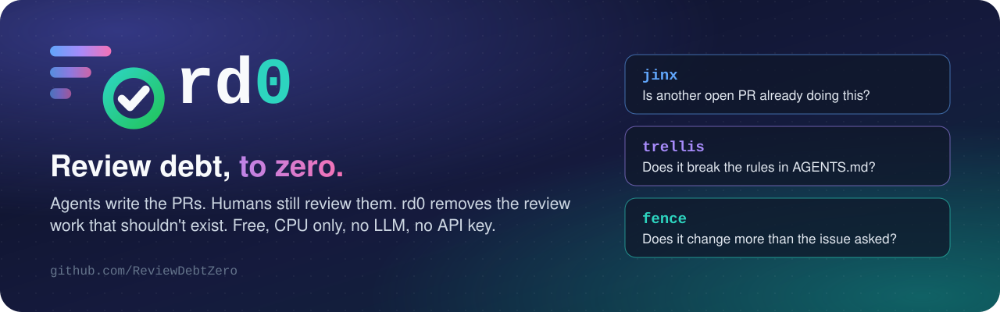

<p align="center"></p>

# rd0: review debt, to zero

One agent skill that runs the three rd0 checks on a branch **before** the PR is opened, so the coding agent
cleans up review debt instead of handing it to a human.

| Tool | Catches | Repo |
|---|---|---|
| Jinx | an open PR that already does the same work | [rd0-jinx](https://github.com/ReviewDebtZero/rd0-jinx) |
| Trellis | broken AGENTS.md / CLAUDE.md rules, workaround comments, bare suppressions, commented-out code | [rd0-trellis](https://github.com/ReviewDebtZero/rd0-trellis) |
| Fence | edits outside what the task asked for | [rd0-fence](https://github.com/ReviewDebtZero/rd0-fence) |

No LLM, no API key, CPU only. The agent passes the task text verbatim; the checks only advise. Keep each
tool's GitHub Action in CI as the independent check.

## Use it

**Claude Code** (and other tools that read Agent Skills): copy `skills/rd0/` to `.claude/skills/rd0/` in your
repo, or `~/.claude/skills/rd0/` for all repos.

**Codex, Cursor, Copilot, Devin:** paste [`agents/AGENTS-snippet.md`](agents/AGENTS-snippet.md) into your
`AGENTS.md` and put [`rd0-check.sh`](skills/rd0/scripts/rd0-check.sh) on your PATH.

**By hand:**

```bash
pip install rd0-jinx rd0-trellis \
  "git+https://github.com/ReviewDebtZero/rd0-fence#subdirectory=packages/rd0-fence"
skills/rd0/scripts/rd0-check.sh --title "truncate() crashes on negative n" --body-file task.txt --base origin/main
```

```text
== Fence: changes outside the task
fence: 2 part(s) outside the issue's scope, 4/7 changed lines (57%)
  [high] requirements.txt (+/-2): changes dependencies or package metadata; the issue does not ask for that
  [high] utils/dates.py (+/-2): edits a code file (changes `parse`) that no path, name or term in the issue points to

== Trellis: repo rules and agent slop
1 finding(s).
  WARN  requirements.txt  [scope] This file is outside the area the PR description names.
        fix: Revert it, or explain in the PR description why this PR has to change it.
...
== Jinx: open PRs that may already do this
PR #0: checked 2 open PRs in 3 ms. 0 likely duplicate(s) (score >= 0.50).
             #7  score 0.24  Raise ValueError when truncate gets negative n
               - shares 1 of 3 changed files (utils/text.py)
```

Jinx fetches open PRs with the GitHub CLI (`gh`); elsewhere pass `--queue open_prs.json`
(`[{number, title, body, files: [paths]}]`).

## Website

`web/` is the rd0 site (Next.js static export, Netlify-ready via `netlify.toml`): one page listing Jinx, Trellis
and Fence with links to each tool's own site. Build: `cd web && npm ci && npm run build` (output in `web/out`).
All URLs live in `web/src/data/site.ts`, so pointing it at a custom domain is one edit.

## Status

Early. Each tool's accuracy is reported in its own repo; Fence and Trellis benchmarks are still in progress.
Whether running these checks inside the agent loop reduces review debt is not yet measured.

MIT licensed.
